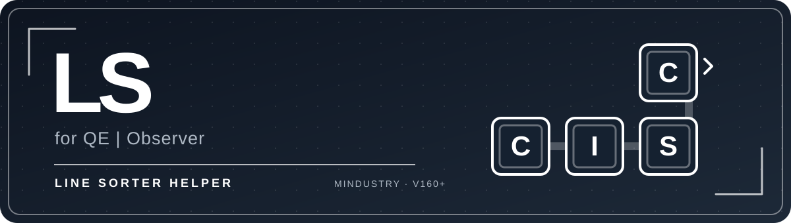
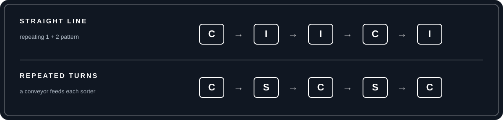

<strong>CLIENT-SIDE</strong> &nbsp; ◇ &nbsp; <strong>JAVASCRIPT</strong> &nbsp; ◇ &nbsp; <strong>MINDUSTRY V160+</strong>

# Line Sorter Helper

A client-side JavaScript mod for Mindustry build 160 and newer. It changes the local player's conveyor build plans while dragging a line. It does not add blocks or change existing world tiles.

## ◇ What it does

With a normal or titanium conveyor selected, straight lines follow a repeating pattern:

`conveyor → inverted sorter → inverted sorter`

On a turn, the mod uses a regular sorter only if the preceding tile is a conveyor. Consecutive turns alternate between a regular sorter and a conveyor. Any run of three sorters is broken by a conveyor. Mindustry's bridge and junction substitutions are preserved.

The pattern starts over for each new line. It is visible while dragging and applied to the build queue after release.

## ◇ Controls

- Click the small **sort on / sort off** button on the left side of the HUD, or press **F8**. The setting is saved.
- Hold **Ctrl** while dragging diagonally to make a stepped line with turns.

## ◇ Install

Once the [GitHub repository](https://github.com/azuredx/LineSorter) appears in Mindustry's Mod Browser, install it there. To test it earlier, use **Mods → Import Mod → Import From GitHub** and enter `azuredx/LineSorter`, or import a ZIP containing this repository's files. Restart Mindustry when prompted.

The mod works on the local player's plans and still requires the usual block unlocks, resources, and building permissions. Script support is required on the device.

## ◇ Mod Browser and updates

This public repository has the `mindustry-mod` topic and is indexed automatically by [MindustryMods](https://github.com/Anuken/MindustryMods). The listing can take a few hours to refresh. For this JavaScript mod, the browser downloads the latest default-branch commit unless a game-version-specific release applies.

For later updates, increase the three-part `version` in `mod.hjson` and push the new files. The game uses that version to detect updates. Keep `mod.hjson` and `icon.png` at the repository root, with the script at `scripts/main.js`.

`minGameVersion: 160` declares the supported game build. `hidden: true` marks this script-only mod as multiplayer-compatible; it does **not** hide it from the Mod Browser. `hideBrowser: true` would hide it and is intentionally absent.

The browser listing itself is automatic. No pull request to the MindustryMods index is needed.
